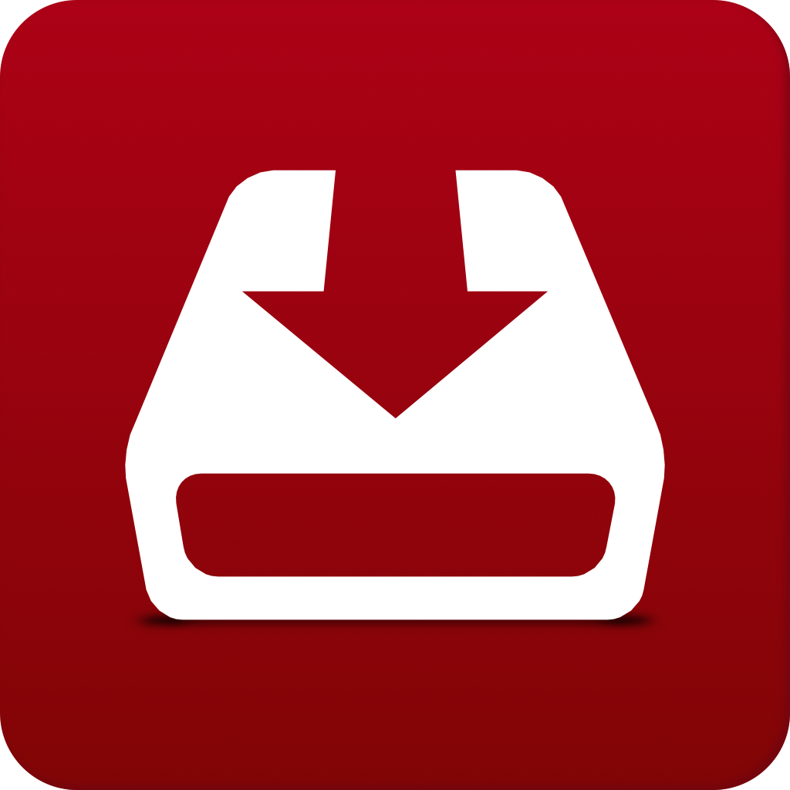

<p align="center"></p>

<h1 align="center">Glass Crate</h1>

<p align="center"><strong>A simple, transparent way to save video and audio on your Mac.</strong><br>
Like a crate made of glass, there's nothing hidden inside. It tells you exactly what it uses, where it keeps it, and removes all of it when you're done.</p>

<p align="center"><a href="https://github.com/nine00p/glasscrate/releases/latest"><strong>Download the latest version</strong></a> · macOS 13 Ventura or newer · Apple Silicon and Intel · Free</p>

---

## Why it exists

I wanted a way to download video and audio for my mashups and remixes. Most of the downloaders out there were loaded with spyware, and some had malware built right in. So I built my own, and made it open source, so anyone can see exactly what it does.

## What it does

- **Browse right inside the app.** A phone-sized browser for YouTube and SoundCloud. Find a video or track and click **Add to Crate**.
- **Video and audio, all at once.** MP4 video, plus MP3, WAV, and AIFF, in any combination, each saved as its own file.
- **A Download Queue.** Line up as many as you like. They download one at a time, show their size and speed, and pick up where they left off if you quit.
- **Album art and tags.** MP3s get the thumbnail as square album art, and files are tagged with title, artist, and album.
- **Ready for DJ software.** WAV and AIFF for Serato, rekordbox, Engine DJ, and the rest, with their own folder if you like.
- **Updates, the Mac way.** You choose when to download and install updates to the tools it uses. No pop-ups.
- **Themes and Interface Size.** Light, Crimson, Dark, and Blackout themes, plus the Mac's own looks, and sizes from 70% to 130%.
- **Leaves no trace.** Uninstall removes the app, its tools, its settings, and its browsing data. Only your downloaded files stay.

## Exactly what it installs

Glass Crate itself is small. The first time it opens, a setup screen lists the free, open-source tools it uses, with links to each one's official site, and downloads nothing until you click **Begin Setup**.

| Tool | What it does | Comes from |
|---|---|---|
| **yt-dlp** | Downloads the video and audio | [github.com/yt-dlp/yt-dlp](https://github.com/yt-dlp/yt-dlp) |
| **FFmpeg** | Joins video and audio, converts to MP3, WAV, or AIFF, adds album art | [ffmpeg.org](https://ffmpeg.org), Mac build by [Martin Riedl](https://ffmpeg.martin-riedl.de) |
| **FFprobe** | FFmpeg's companion; checks each file before it's converted | Same as FFmpeg |
| **Deno** | Helps yt-dlp read YouTube's pages | [deno.com](https://deno.com) |

About 200 MB in total, kept in one folder: `~/Library/Application Support/Glass Crate`. No Homebrew, no Terminal, no password, no account, no ads, no analytics, and nothing running in the background. (The websites you browse inside Glass Crate show their own ads.)

## Installing

1. Download **Glass Crate** from the [latest release](https://github.com/nine00p/glasscrate/releases/latest) and open the DMG.
2. Drag **Glass Crate** onto the **Applications** folder.
3. The first time you open it, macOS will stop it, because the app isn't registered with Apple yet. Go to **System Settings → Privacy & Security**, scroll down, and click **Open Anyway**. You only do this once.
4. On the setup screen, click **Begin Setup**.

## Building it yourself

You only need Apple's free Command Line Tools (Xcode works too). No Xcode project, no package manager.

```
xcode-select --install     # once, if you don't have the tools yet
cd dev
./build.sh                 # builds Glass Crate.app into beta/
./release.sh               # packages it as a DMG in releases/
```

The code is in `dev/`, and the app icon is `artwork/icon.png`.

| File (in `dev/`) | What's in it |
|---|---|
| `GlassCrate.swift` | The app, its menus, and the main window |
| `Browser.swift` | The built-in browser (Browse Media) |
| `Downloader.swift` | One download: runs yt-dlp and reports progress |
| `Queue.swift` | The Download Queue and its panel |
| `Setup.swift` | First-time setup: downloads the tools |
| `Updates.swift` | Settings → Updates: tool updates |
| `Settings.swift` | The Settings window |
| `Appearance.swift` | Themes, Interface Size, and text sizes |
| `Tagging.swift` | Artist and album tags, and album art |
| `Uninstaller.swift` | Uninstall |
| `About.swift`, `About.md`, `CHANGELOG.md` | The About and What's New windows |

## Responsible use

Only download content you own or have permission to save. Glass Crate is built for working with your own material and material you have the rights to use. Downloading from a site may be against that site's terms.

## License

Copyright © 2026 nine00p. Glass Crate is free software under the **GNU General Public License v3.0**. You can use, study, change, and share it, and anything you share that's based on it must stay open source under the same license. See [LICENSE](LICENSE).

The tools it downloads have their own licenses: yt-dlp (Unlicense), FFmpeg (GPL/LGPL, depending on the build), and Deno (MIT).
